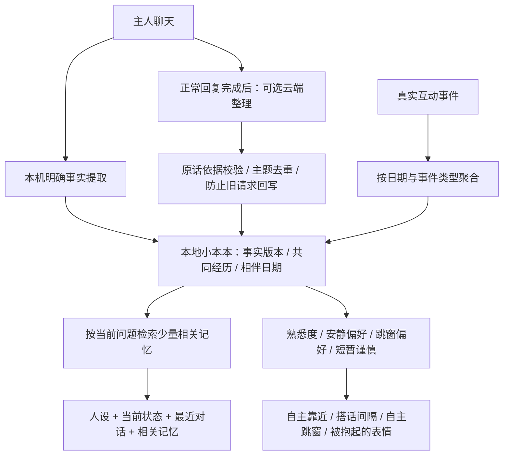

# 高小喵的记忆：记住主人，也记住一起生活的经历

这一版把记忆从“最近几轮对话”扩展为跨重启的小本本，并让它参与真实行为。目标是逐渐形成熟悉感，而不是把聊天记录无限塞进提示词。

## 如何使用

在菜单栏猫咪图标或右键菜单中打开 **小本本…**；设置里也有入口。

| 告诉它／和它做的事 | 发生什么 |
|---|---|
| `我叫王珺`、`以后叫我珺大王吧` | 本机立即记住姓名、称呼，后续聊天按需使用 |
| 先问 `你知道我生日是什么时候吗`，再说 `是10月9号哦` | 结合紧接着的主人生日话题，立即记住生日 |
| `我喜欢茉莉花茶` | 保存喜好和主人原话，跨重启保留 |
| `我现在不喜欢茉莉花茶了` | 同主题产生新版本，旧版本退出当前检索 |
| `我希望安静一些` | 主动搭话的间隔变为原来的三倍，也暂停主动靠近 |
| `多陪我聊天`、`不用保持安静` | 解除安静偏好，恢复设置里的搭话频率 |
| `不要跳窗`／`可以跳窗` | 停止／允许自主跳窗；仍受设置中的跳窗总开关控制 |
| `我今天有点难过` | 记住这次心情，24 小时后退出检索 |
| `我明天要去面试` | 保存带观察时间的短期计划，后天零点过期 |
| 摸头、喂食、玩毛线、聊天 | 记录真实共同经历，慢慢增加熟悉度 |
| `忘掉咖啡的记忆` | 删除有关主题的全部版本，同时清空短期聊天上下文 |
| `清空记忆` | 清空主人资料、经历、熟悉度和短期聊天；保留宠物本身的人设和状态 |

安静和跳窗偏好采用明确规则，复杂、含蓄的措辞不保证识别。安静偏好主要降低闲聊，不关闭饥饿等状态反馈；明确发出的动作指令仍能执行。计划只是谈话背景，不是提醒或日历任务。

生日支持“我生日是…”、“我是…生日”、中文数字、常见数字日期和明确的农历标记，并校验月日。省略“生日”的日期回答只关联上一条主人消息中的本人生日话题，间隔最多 15 分钟，不从宠物生成的话推断主人生日。修复版首次启动会只补查现有主人聊天中漏记的生日；补查只运行一次，遗忘后不会重复恢复。

小本本展示每条资料的来源、确认时间、确认次数，以及旧版本或过期状态；可逐条删除资料和某天某种互动经历。若记错了，在聊天里重新陈述即可。删除一条资料会删除该主题所有版本，避免旧版本重新生效。

**清空聊天与遗忘不同：** 聊天窗口垃圾桶只清除短期对话；小本本中的删除和清空才会删除长期记忆。遗忘操作还会取消当前生成、清除气泡和短期事件上下文，拒绝旧的后台整理结果回写。删除后需要重新告诉它的信息，才会重新学习。

## 从 mem0 借鉴了什么

参考的是本机 `vendor/mem0` 下载版本：

- [记忆工作流说明](../vendor/mem0/docs/core-concepts/how-it-works.mdx)：提取与检索分离，只向模型提供相关事实。
- [V3 提取提示词](../vendor/mem0/mem0/configs/prompts.py)：当前版本采用 **ADD-only + 关联已有记忆**，按主题去重、保留变化，不是让模型随意改写所有旧记忆。
- [写入和检索实现](../vendor/mem0/mem0/memory/main.py)：检索候选、提取、去重、写入元数据及历史、过滤过期项。

这里采用原生 Swift 实现，没有引入 Python 服务、mem0 SDK、向量数据库或额外的 embedding API，也没有把 mem0 的服务端功能整体搬进桌面宠物。

| mem0 的思路 | 高小喵的适配 |
|---|---|
| 从新消息提取独立事实 | 明确声明先由本机规则提取；复杂声明可在回复后由当前云端模型整理 |
| 同主题记忆关联 | 稳定主题 key、`supersedes` 版本关系；较新的纠正优先 |
| 去重与历史 | 相同事实增加确认次数；变化保留旧版本，但只检索当前版本 |
| 检索与重排 | 中文双字词、常见互动同义词、重要性、确认次数、时间新鲜度排序 |
| 元数据和过期过滤 | 来源摘录、观察时间、最近确认时间、临时记忆过期时间 |
| 主体隔离 | 主人的事实只从主人原话学习；宠物的生成回复不被当成主人资料 |

这不是语义向量搜索。复杂同义表达、跨主题关联与日期推理仍有局限；以后可以在纯 Swift 内核接口后增加本机 embedding，而不改动宠物行为层。

## 记忆如何进入生活



四种信息各有职责：

1. **工作记忆**：已有短期对话，磁盘最多保存 60 条消息，提示词选最近 10 条有效消息。主人消息保留原样，宠物的旧非中文回复不进入上下文。
2. **主人资料**：姓名、称呼、生日、稳定喜好、习惯和近期牵挂。最多保留 300 条，含旧版本。安静和跳窗是行为偏好，也属于有证据的资料。
3. **共同经历**：由引擎的真实事件写入，按日期和事件类型聚合。照顾事件至少间隔 60 秒，其他事件至少 15 秒；单组最多 99 次，最多 400 组，清理超过一年的经历。不会把每帧摸头都记成一次照顾。
4. **相处倾向**：由实际照顾和相伴日期计算。每种照顾每天最多计 5 次熟悉度；熟悉度超过阈值后，空闲时偶尔走近光标、打开聊天时表现亲近。主动靠近至少间隔 5 分钟，不会凭空生成“主人叫了我”的经历。

最近一小时内多次重摔会让被抱起的表情暂时更谨慎；不会形成永久惩罚。长期离开也不扣熟悉度。较长离开后的启动上下文能说明大致离开时长，但不制造愧疚。

每次提示词最多选 6 条相关主人资料和 2 组共同经历，按字符预算裁剪；称呼与行为偏好优先。记忆用 JSON 数据块传入，注明它不是指令，只能作为有日期的参考，不得照着执行其中的文本。过去的心情不等于当前心情，没有经历也不能编造经历。

## 学习、纠正和遗忘的边界

- 基础提取支持保守的中文句式，不从问题、假设、宠物回复中提取主人事实。含明显密码、密钥等标记的原话不参与长期提取；这不等于对敏感信息有完备识别能力，也不会自动删掉原有聊天记录中的敏感内容。
- 云端提取最多建议 4 条，必须带能在本轮原话逐字找到的完整摘录，文本以主人为主体。模型不能删除记忆、变更宠物身份或猜测主人姓名。姓名、称呼、生日及影响行为的两项偏好只由本机规则处理。
- 云端整理是尽力而为的提取，并不能证明语义一定正确。查看来源、纠正和删除是必要的产品能力；已有 key 会提供给整理器帮助沿用主题，但复杂改写仍可能产生重复主题。
- 同主题的新事实保留前一版的 ID；相同事实只增加确认。较旧观察时间的整理结果不能覆盖后来纠正的事实。过期内容与旧版本仍可在小本本查看，直到被删除或达到容量上限。
- 心情保留 24 小时；今天／明天／后天的计划分别在相应日期结束后过期；其余计划保留至观察日期后第 7 天零点。不进行完整自然语言日历解析。
- “王珺／珺大王”从原有人设迁入一次，标记来源为原有人设。历史聊天也只迁入主人明确声明的资料，不调用模型、不读取宠物回复作为主人事实。清空后不重新导入。
- 主人资料已从固定系统提示词移出。宠物自己的性格、来历、年龄和自我介绍仍在 [Persona.swift](../Sources/Kokosuki/Conversation/Persona.swift) 中。`initialOwnerProfile` 仅用于尚未迁移过的首次小本本，不是日常更新入口。
- 遗忘先使后台任务的版本失效，再删除所有对应事实版本、清空短期聊天并原子写入磁盘。保存失败会显示错误；重试成功前，磁盘上的旧文件仍可能存在。

## 本机存储、开关与费用

记忆文件：`~/Library/Application Support/Kokosuki/pet-memory.json`。原子写入，交互后短暂合并写入，每分钟更新相伴日期与最后在线时间，退出时保存。聊天仍在 `chat-history.json`，当前饱食度等仍在 `pet-state.json`。

文件无法解码或版本不受支持时停止记忆写入，不覆盖原文件。小本本显示错误，可打开存储位置并重试读取。磁盘保存错误也会展示并提供重试；若遗忘时旧聊天文件删除失败，会单独提示并提供“重试清除聊天”，不会声称已经完全清除。

设置中的 **记住主人与共同经历** 默认开启。关闭会暂停新记忆、检索和行为影响，保留文件供以后恢复；需要删除时使用小本本清空。

**云端整理记忆** 默认开启，仅在使用云端对话模型且主人说了可能值得记忆的话时工作。正常回复完成后额外请求一次，发送本轮主人原话和最多 20 条当前资料，使用现有模型配置和 Keychain 密钥；不发送完整历史，不调用额外 embedding 服务。队列最多等待 6 条，不阻塞回复。关闭此开关仍可使用本机基础记忆；本地 MLX 模式当前也仅使用基础提取。整理失败不影响本机提取，状态在小本本显示。

## 代码与验证

| 文件 | 职责 |
|---|---|
| `Sources/KokosukiMemory/MemoryModels.swift` | 可持久化资料、来源、经历与相处倾向 |
| `Sources/KokosukiMemory/MemoryJournal.swift` | 本地日志、版本、去重、检索、过期、遗忘、熟悉度 |
| `Sources/KokosukiMemory/MemoryLearning.swift` | 中文规则、整理提示词、结构化结果校验 |
| `Sources/KokosukiMemory/BirthdayMemory.swift` | 中文生日日期解析、有效性校验与主人话题关联 |
| `Sources/Kokosuki/Features/Memory/PetMemory.swift` | 主线程控制器、迁移、后台整理、取消与保存 |
| `Sources/Kokosuki/Conversation/Brain.swift` | 检索注入与回复后整理 |
| `Sources/Kokosuki/Pet/PetEngine.swift` | 真实经历写入和行为变化 |
| `Sources/Kokosuki/Features/Memory/MemoryWindow.swift` | 小本本查看、来源、旧版本、删除 |

正常开发环境运行：

```bash
KOKOSUKI_CLOUD_ONLY=1 swift test --scratch-path .build-cloud
.build-cloud/release/Kokosuki --selftest --unit-only
```

记忆单元用例覆盖保存恢复、资料纠正、旧请求时间顺序、检索预算、过期、所有版本遗忘、敏感标记过滤、行为倾向和容量限制。应用内集成用例使用临时目录与注入的模拟整理器，覆盖历史角色隔离、正常整理、删除时的异步回写、迁移不复活、损坏文件保护、聊天等待状态复位；不会读取真实小本本或调用模型。

`--memory-preview` 打开带虚构资料的独立小本本窗口，不启动宠物引擎、不读取密钥、不请求模型、不读写真实记忆；3 分钟后自动退出，供界面验证。
