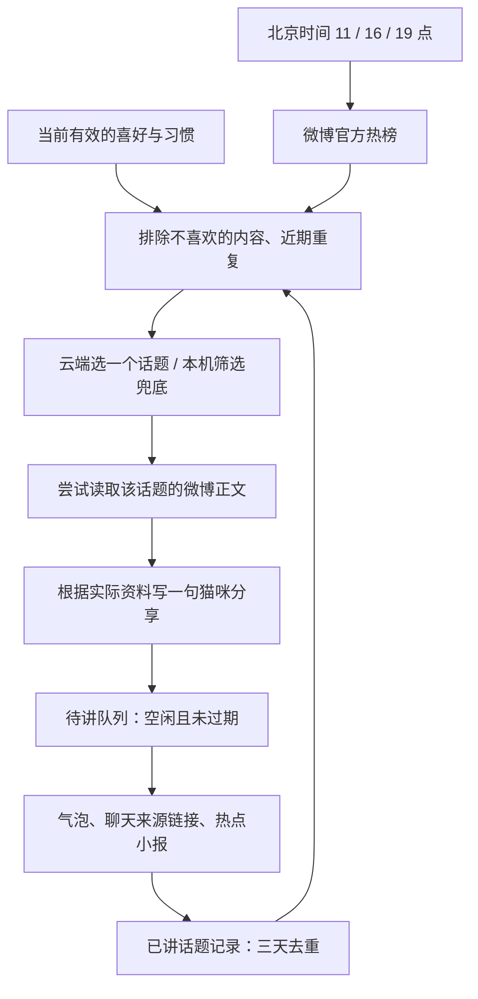

# 高小喵的定时微博热点

每天北京时间 **11:00、16:00、19:00**，高小喵读取微博热搜，结合记忆中的主人偏好选一个新话题，等空闲时主动讲。来源和详情保留在“热点小报”，聊天中也提供可点击的微博链接。

## 使用

1. 退出旧版并打开 `build/Meow.app`，设置中的“定时分享热点”默认开启。
2. 告诉它兴趣，例如 `我关注人工智能`、`我对萌宠感兴趣`、`我不喜欢娱乐八卦`。这些明确表达会写入原有小本本；纠正或删除记忆后，后续选题随之变化。
3. 猫咪菜单或设置 → **热点小报…**，查看当前状态、已讲内容、抓取时间和微博来源，也可以点 **现在找一条** 立即尝试。

定时分享有独立开关，不受随机闲聊频率控制。每个时段最多讲一条，没有新的合适话题就不打扰。用户手动找热点不占用下一个定时时段，但仍执行重复话题过滤。

小喵需要保持运行和联网。它不安装系统后台服务，不会在应用退出或电脑休眠时自行唤醒电脑。启动、唤醒后只补一小时内最近的一期；例如 16:25 恢复时可以补 16:00 这一期，17:00 以后不再补。定时检查间隔 15 秒，实际开口时间还取决于联网、模型响应和是否空闲。

忙于聊天、睡觉、被抱起、动作中或已有气泡时不打断；话题排队至空闲，超过本期一个小时就跳过。普通闲聊不影响选题请求，新闻请求也不会取消用户聊天。

## 参考项目的适配

参考本地 [weibo-hot-with-your-taste](../vendor/weibo-hot-with-your-taste/README.md) 及其 [抓取](../vendor/weibo-hot-with-your-taste/scripts/fetch.py)、[推送](../vendor/weibo-hot-with-your-taste/scripts/push.py)、[接口说明](../vendor/weibo-hot-with-your-taste/references/weibo-api-header.md) 的设计。原项目按“热榜抓取 → 规则筛选 → 模型核校 → 补充详情 → 去重推送”工作。这里以原生 Swift 实现，推送终点改为桌面气泡、聊天和热点小报；主人偏好直接来自高小喵现有记忆。

## 数据来源与内容边界

- 热榜首先请求微博官方 `https://weibo.com/ajax/statuses/hot_band`，带正常浏览器请求头和 `Referer: https://weibo.com/`；失败或空榜时尝试 `https://weibo.com/ajax/side/hotSearch`。
- 清理广告、无排名置顶项和同名重复项，保留标题、分类、排名、热度及本次抓取时间。不会把接口中的任意 URL 当成新闻链接；来源链接由本机根据标题生成微博搜索地址。
- 选题后尝试 `m.weibo.cn/api/container/getIndex` 的话题搜索，最多取三段正文，每段最多 600 字。支持嵌套卡片、去掉 HTML 标签、保留单条微博链接。
- 微博可能要求登录、访客验证或更改接口。详情读取失败时，仍可分享真实抓到的热搜题目；小报明确注明没有取得详情。不会用模型补出缺失的事件经过、数字或结论。
- 热搜与微博发言是讨论资料，不等同于经过核实的新闻事实。写稿提示词要求区分这两者；主人追问时可以使用三小时内最近已分享话题当时取得的资料，并说明这不是重新联网查询。
- 未能取得热榜则本期不编造内容。定时失败最多尝试三次，至少间隔五分钟，且受一小时补抓窗口限制。手动重试由用户触发。

默认尝试公开访问，无需为了热榜预先填写微博凭据。如需登录，可在小报里的 **微博登录凭据（可选）** 粘贴自己已登录微博的完整 Cookie。凭据仅保存在 macOS 钥匙串 `com.kokosuki.pet.weibo`，只发给微博官方请求，不进入模型提示词、缓存或日志。遇到登录重定向时停止跟随，交由用户在微博正常登录后更新凭据。清空输入并保存可移除凭据。

## 如何结合记忆

只读取启用状态下、未过期且未被替代的喜好与习惯，最多二十条；姓名、生日等个人档案不会进入新闻选题请求。相处中的安静、跳窗指令也不作为选题兴趣。

明确不喜欢的词和常见分类在本机先排除，再按兴趣关键词、常见同义词及排名排序。云端模型在这批真实候选中选择一个序号，或选择不分享；返回的序号必须属于候选集合。无法使用模型时，采用本机筛选；已知正面兴趣却没有匹配项时不强推无关内容。没有兴趣记忆时，优先一般公共话题。

同一话题及高度相似标题，在实际分享后的三天内不再次主动讲；模型也会看到近期标题，以避开同一事件的不同说法。这是有界的关键词、近似标题和模型判断，并非完备的事件聚类。

微博资料按不可信数据传入模型，不能改写小喵身份、执行指令或增加主人事实。新闻不会写入主人资料记忆；只在实际分享后进入助手聊天记录，并保留来源。遗忘主人资料会取消旧新闻任务、清除待讲与已保存的个性化小报和近期标题，避免旧任务恢复已遗忘的信息；本期调度记录保留，防止同一时段再次启动。

## 模型调用与存储

复用现有火山云端模型配置和 API Key：一次选题、一次写稿，每轮流程最多两次额外模型请求。不启用深度思考。手动触发或中断后的重试可能增加当天调用数。若当前配置为本地模型或模型不可用，使用本机筛选和包含真实标题的固定分享句，不额外调用本地模型。

热点记录位于 `~/Library/Application Support/Kokosuki/weibo-news.json`，与主人记忆分开：

- 调度尝试与完成记录保留七天；失败次数和本期状态在抓取前先写入。
- 待讲内容保存一条，正常重启可恢复未过期的话题，已完成时段不会重新抓取。
- 已分享小报保留最多六十条、三十天；去重标题保留三天、最多三百条。
- 文件使用原子写入。损坏或版本不兼容时停止抓取与写入，保留原文件，并在小报显示错误和重试入口。

## 代码与验证

| 位置 | 职责 |
|---|---|
| `Sources/KokosukiNews/` | 纯 Swift 调度、微博解析与 HTTP 客户端、兴趣筛选、去重、结构化选题 |
| `Sources/Kokosuki/Features/News/HotNewsController.swift` | 调度持久化、后台流程、重试、待讲和遗忘取消 |
| `Sources/Kokosuki/Features/News/NewsWindow.swift` | 热点小报、来源、手动触发、登录凭据入口 |
| `Sources/Kokosuki/Features/News/WeiboCookieStore.swift` | 独立钥匙串存储 |
| `Sources/Kokosuki/Pet/PetEngine.swift` | 空闲时实际分享，不打断聊天与睡眠 |

`KOKOSUKI_CLOUD_ONLY=1 swift test --scratch-path .build-cloud` 包含热点单元测试；`--selftest --unit-only` 包含模拟时钟与注入数据源的应用集成检查，全程不请求网络、不读取真实凭据或修改真实记录。覆盖固定时区、补抓窗口、重试次数、广告过滤、接口备用路径、正文来源、偏好、去重、模型序号校验、重启恢复、遗忘期间旧任务回写和旧聊天格式兼容。

`--news-check` 只真实请求公开热榜并报告数量，不读取微博凭据或模型密钥；`--news-preview` 使用虚构资料预览小报窗口，不访问网络或真实记录，三分钟后自动退出。
